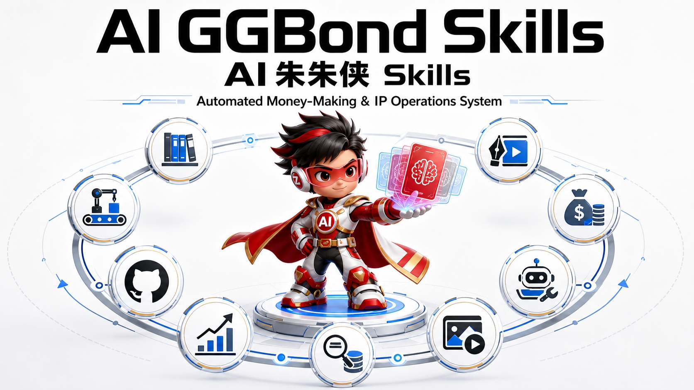

# AI GGBond Skills<br><small>Focus on Making AI Your Automated Money-Making & IP Operations System</small>

<p align="center">
  <a href="https://github.com/BetterZflyee/ai-ggbond-skills/stargazers"></a>
  <a href="https://github.com/BetterZflyee/ai-ggbond-skills/blob/main/LICENSE"></a>
  <a href="https://zflyee.com/"></a>
  <a href="#changelog"></a>
  <a href="README.zh-CN.md"></a>
</p>

<p align="center">
  
</p>

> **A curated collection of Agent Skills for the AI Native solopreneur & OPC.**
>
> Every skill is a complete, battle-tested automation workflow — not a chatbot toy, but an AI workforce that publishes articles, runs social media, tracks trends, and builds knowledge. Plug-and-play. Continuously refined. All lessons learned are preserved in `references/`.

---

## Why AI GGBond Skills

Runs on [Hermes Agent](https://github.com/NousResearch/hermes-agent), [Claude Code](https://claude.ai), [Codex](https://github.com/openai/codex), [OpenClaw](https://github.com/nousresearch/openclaw), and other major AI Agent platforms. Every skill supports **memory & conversation adaptation** — automatically reads your preferences and history for personalized, persona-matched output.

Bring your own model — OpenAI, DeepSeek, OpenRouter (200+ models), Nous Portal, or your own endpoint. Switch models anytime with `hermes model`. The skills don't care.

---

## Skill Matrix

| Skill | Category | What It Does |
|:---|:---|:---|
| `ai-ggbond-article-writer` | 📝 Creative | Full pipeline: topic → outline → draft → typesetting → images → publish to WeChat |
| `ai-ggbond-post-to-wechat` | 🚀 Publishing | One-click push to WeChat Official Account drafts. API + Browser CDP modes |
| `ai-ggbond-sticker-writer` | 🎨 Creative | Convert content to social-ready image cards (Xiaohongshu-style stickers) |
| `ai-ggbond-poster-portrait` | 🎨 Creative | GPT Image 2 portrait poster generation — cinematic, emotional, photography-style female portraits with safety-compliant prompts |
| `ai-ggbond-worldcup-kv-poster` | 🎨 Creative | World Cup country concept KV posters — treat countries as visual brands with high commercial sports aesthetics |
| `ai-ggbond-skill-matrix` | 🧭 Meta | 181-skill routing table across 7 scenarios — trigger words, skill chains, full-pipeline orchestration |
| `ai-ggbond-github-trending` | 🔍 Research | GitHub Trending discovery + AI-powered analysis for AI/Agent/MCP trends |
| `ai-ggbond-x-followings-feed` | 📡 Signal | X dual-source feed (For You + Following) · heat-first curation · AI-structured digest |
| `ai-ggbond-publish-to-x` | 📢 Social | Full-featured X/Twitter publishing: posts, quotes, long-form, Threads |
| `ai-ggbond-run-xiaohongshu` | 📕 Social | End-to-end Xiaohongshu ops: positioning → ideation → creation → publishing → engagement → iteration |
| `ai-ggbond-brain-setup` | 🧠 Knowledge | GBrain memory layer with DashScope/Qwen3-Embedding support — 9 documented pitfalls, proxy config, recipe patching |
| `ai-ggbond-remove-ai-marks` | 🧹 Utility | Remove visible (Gemini sparkle) & invisible (SynthID/C2PA) AI watermarks from images |
| `ai-ggbond-youtube-script` | 🎬 Media | Download YouTube transcripts, subtitles & cover images. InnerTube + yt-dlp fallback + web search triple-fallback |
| `ai-ggbond-long-image-generator` | 🎨 Creative | Generate long infographic images using GPT-Image-2 (Yunwu API). Supports Xiaohongshu, WeChat, super-long presets up to 7200px |
| `ai-ggbond-policy-decoder` | 🔍 Research | Turn any city/domain policy into one specific person's 3/5/10-year trajectory. Two modes: deep policy card (research) + deadline board sorted by ¥/hour (execution) |

> All skills support **persona-adaptive output** (v1.0 milestone) — they automatically read your profile from Hermes Memory and tailor content to your unique voice, instead of producing generic AI-sounding text.

---

## Architecture

### Skill Ecosystem Map

```
┌─────────────────────────────────────────────────────────────────────────────┐
│                           AI GGBond Skills                                   │
│                    (13 Skills × 7 Categories)                                │
├─────────────────────────────────────────────────────────────────────────────┤
│                                                                             │
│  ┌─────────────────────────────────────────────────────────────────────┐   │
│  │                        🧭 META LAYER                                │   │
│  │  skill-matrix ──→ Routes tasks to skill chains                      │   │
│  └─────────────────────────────────────────────────────────────────────┘   │
│                                    │                                        │
│                                    ▼                                        │
│  ┌──────────────────────┐  ┌──────────────────┐  ┌───────────────────────┐ │
│  │    📡 SIGNAL LAYER    │  │  🧠 MEMORY LAYER  │  │    🔍 RESEARCH LAYER  │ │
│  │                      │  │                  │  │                       │ │
│  │  x-followings-feed   │  │   brain-setup    │  │   github-trending     │ │
│  │  (X/Twitter digest)  │  │   (GBrain KB)    │  │   (Open source scan)  │ │
│  └──────────┬───────────┘  └────────┬─────────┘  └───────────┬───────────┘ │
│             │                       │                        │             │
│             └───────────────────────┼────────────────────────┘             │
│                                     │                                       │
│                                     ▼                                       │
│  ┌─────────────────────────────────────────────────────────────────────┐   │
│  │                     📝 CONTENT CREATION LAYER                        │   │
│  │                                                                      │   │
│  │  ┌─────────────┐  ┌──────────────┐  ┌─────────────────────────────┐ │   │
│  │  │ article-    │  │ sticker-     │  │ Visual Content              │ │   │
│  │  │ writer      │  │ writer       │  │                             │ │   │
│  │  │ (Long-form) │  │ (Image cards)│  │  poster-portrait            │ │   │
│  │  └──────┬──────┘  └──────┬───────┘  │  (Portrait posters)         │ │   │
│  │         │                │          │                             │ │   │
│  │         │                │          │  worldcup-kv-poster          │ │   │
│  │         │                │          │  (Sports KV posters)         │ │   │
│  │         │                │          └─────────────┬───────────────┘ │   │
│  └─────────┼────────────────┼────────────────────────┼─────────────────┘   │
│            │                │                        │                      │
│            ▼                ▼                        ▼                      │
│  ┌─────────────────────────────────────────────────────────────────────┐   │
│  │                     🚀 DISTRIBUTION LAYER                            │   │
│  │                                                                      │   │
│  │  ┌──────────────┐  ┌──────────────┐  ┌─────────────────────────────┐│   │
│  │  │ post-to-     │  │ publish-to-x │  │ run-xiaohongshu             ││   │
│  │  │ wechat       │  │              │  │ (Full-ops, built-in publish)││   │
│  │  │ (WeChat OA)  │  │ (X/Twitter)  │  │                             ││   │
│  │  └──────────────┘  └──────────────┘  └─────────────────────────────┘│   │
│  └─────────────────────────────────────────────────────────────────────┘   │
│                                                                             │
│  ┌─────────────────────────────────────────────────────────────────────┐   │
│  │                      🧹 UTILITY LAYER                                │   │
│  │                                                                      │   │
│  │  ┌──────────────────┐  ┌──────────────────────────────────────────┐ │   │
│  │  │ remove-ai-marks  │  │ youtube-script                          │ │   │
│  │  │ (Watermark clean)│  │ (Transcript/Subtitle download)          │ │   │
│  │  └──────────────────┘  └──────────────────────────────────────────┘ │   │
│  └─────────────────────────────────────────────────────────────────────┘   │
│                                                                             │
│  ┌─────────────────────────────────────────────────────────────────────┐   │
│  │                   🎯 PERSONA ADAPTATION LAYER                        │   │
│  │                  (Hermes Memory / User Profile)                       │   │
│  │        Auto-reads your voice, style, positioning for output          │   │
│  └─────────────────────────────────────────────────────────────────────┘   │
└─────────────────────────────────────────────────────────────────────────────┘
```

### Workflow Chains

Every skill can be used standalone or chained into automation pipelines:

#### Content Pipeline Chains

```
┌─────────────────────────────────────────────────────────────────────┐
│                    PRIMARY CONTENT PIPELINE                          │
│                                                                      │
│  Signal Sources          Content Creation         Distribution       │
│  ──────────────         ────────────────         ────────────       │
│                                                                      │
│  x-followings-feed ──┐                                               │
│                      ├──→ article-writer ──→ post-to-wechat          │
│  github-trending ────┘        │                                      │
│                               │                                      │
│                               ├──→ sticker-writer ──→ (manual share) │
│                               │                                      │
│                               └──→ publish-to-x                      │
│                                                                      │
└─────────────────────────────────────────────────────────────────────┘
```

#### Visual Content Chains

```
┌─────────────────────────────────────────────────────────────────────┐
│                    VISUAL CONTENT PIPELINE                           │
│                                                                      │
│  article-writer ──→ poster-portrait (cover image)                    │
│                                                                      │
│  article-writer ──→ worldcup-kv-poster (event-themed cover)          │
│                                                                      │
│  article-writer ──→ sticker-writer (social cards)                    │
│                                                                      │
│  poster-portrait ──→ remove-ai-marks ──→ publish                     │
│                                                                      │
└─────────────────────────────────────────────────────────────────────┘
```

#### Research & Memory Chains

```
┌─────────────────────────────────────────────────────────────────────┐
│                    RESEARCH & MEMORY PIPELINE                        │
│                                                                      │
│  github-trending ──→ article-writer ──→ brain-setup (ingest)         │
│                                                                      │
│  x-followings-feed ──→ article-writer ──→ brain-setup (ingest)       │
│                                                                      │
│  youtube-script ──→ article-writer (reference material)              │
│                                                                      │
│  brain-setup ──→ article-writer (recall knowledge)                   │
│                                                                      │
└─────────────────────────────────────────────────────────────────────┘
```

#### Full-Stack Operations Chains

```
┌─────────────────────────────────────────────────────────────────────┐
│                    FULL-STACK OPERATIONS                             │
│                                                                      │
│  Xiaohongshu Ops:                                                    │
│  run-xiaohongshu ──→ (internal: ideation → content → publish)        │
│       ↑                                                              │
│       └── brain-setup (persona positioning)                          │
│                                                                      │
│  X/Twitter Full Loop:                                                │
│  x-followings-feed ──→ publish-to-x (hot take)                       │
│       │                                                              │
│       └── article-writer ──→ publish-to-x (long-form)                │
│                                                                      │
│  Multi-Platform Syndication:                                         │
│  article-writer ──┬──→ post-to-wechat (primary)                      │
│                   ├──→ sticker-writer ──→ run-xiaohongshu             │
│                   └──→ publish-to-x (cross-post)                     │
│                                                                      │
└─────────────────────────────────────────────────────────────────────┘
```

### Complete Skill Combination Matrix

| Source Skill | → Target Skill(s) | Use Case |
|:---|:---|:---|
| `x-followings-feed` | `article-writer`, `publish-to-x` | Signal → article or hot take |
| `github-trending` | `article-writer` | Open source → trend article |
| `youtube-script` | `article-writer` | Video transcript → article reference |
| `article-writer` | `post-to-wechat` | Long-form → WeChat publish |
| `article-writer` | `publish-to-x` | Long-form → X post or thread |
| `article-writer` | `sticker-writer` | Article → social image cards |
| `article-writer` | `poster-portrait` | Article → cinematic cover image |
| `article-writer` | `worldcup-kv-poster` | Article → event-themed KV poster |
| `article-writer` | `brain-setup` | Knowledge → long-term memory |
| `article-writer` | `run-xiaohongshu` | Article → Xiaohongshu content |
| `poster-portrait` | `remove-ai-marks` | Generated image → clean for publish |
| `worldcup-kv-poster` | `remove-ai-marks` | Generated image → clean for publish |
| `sticker-writer` | `remove-ai-marks` | Generated image → clean for publish |
| `run-xiaohongshu` | `brain-setup` | Engagement data → memory |
| `brain-setup` | `article-writer`, `sticker-writer`, `run-xiaohongshu` | Memory → persona-adaptive output |
| `skill-matrix` | ALL | Task routing → skill chain selection |

---

## Quick Install

### Universal Installation (All Platforms)

Skills are standard `SKILL.md` files with `references/` directories. Copy them to your AI Agent's skill directory:

```bash
# Clone the repository
git clone https://github.com/BetterZflyee/ai-ggbond-skills.git /tmp/ai-ggbond-skills

# Copy skills to your agent's skill directory
# Replace <SKILL_DIR> with your platform's skill path (see below)
cp -r /tmp/ai-ggbond-skills/skills/ai-ggbond-* <SKILL_DIR>/
```

### Platform-Specific Setup

#### Hermes Agent

```bash
# Skill directory: ~/.hermes/skills/
cp -r /tmp/ai-ggbond-skills/skills/ai-ggbond-* ~/.hermes/skills/

# Verify
hermes skills list | grep ai-ggbond

# Update
cd /tmp/ai-ggbond-skills && git pull
cp -r skills/ai-ggbond-* ~/.hermes/skills/
```

#### 单个技能：一条命令安装

不是每个技能都要装整套。`ai-ggbond-policy-decoder` 支持独立安装（自动备份旧版本 + 装完自检）：

```bash
curl -fsSL https://raw.githubusercontent.com/BetterZflyee/ai-ggbond-skills/main/skills/ai-ggbond-policy-decoder/install.sh | bash
```

装到自定义目录（Claude Code / Codex / 任意 agent）：

```bash
curl -fsSL https://raw.githubusercontent.com/BetterZflyee/ai-ggbond-skills/main/skills/ai-ggbond-policy-decoder/install.sh | bash -s -- --dir ~/.claude/skills
```

> 只依赖 `python3` 标准库——**不需要 pip install，不需要任何 API Key，不联网抓数据**。

#### Claude Code

```bash
# Skill directory: ~/.claude/skills/ or project .claude/skills/
mkdir -p ~/.claude/skills
cp -r /tmp/ai-ggbond-skills/skills/ai-ggbond-* ~/.claude/skills/

# Or install to a specific project
mkdir -p /path/to/your/project/.claude/skills
cp -r /tmp/ai-ggbond-skills/skills/ai-ggbond-* /path/to/your/project/.claude/skills/
```

#### Codex (OpenAI)

```bash
# Skill directory: ~/.codex/skills/ or project .codex/skills/
mkdir -p ~/.codex/skills
cp -r /tmp/ai-ggbond-skills/skills/ai-ggbond-* ~/.codex/skills/
```

#### OpenClaw

```bash
# Skill directory: ~/.openclaw/skills/
mkdir -p ~/.openclaw/skills
cp -r /tmp/ai-ggbond-skills/skills/ai-ggbond-* ~/.openclaw/skills/
```

#### Generic Agent (Custom)

```bash
# Any agent that reads SKILL.md files from a skill directory
# Just copy the skills to wherever your agent looks for them
cp -r /tmp/ai-ggbond-skills/skills/ai-ggbond-* /your/agent/skill/path/
```

### Install Individual Skills

```bash
# Install only the skills you need
cp -r /tmp/ai-ggbond-skills/skills/ai-ggbond-article-writer <SKILL_DIR>/
cp -r /tmp/ai-ggbond-skills/skills/ai-ggbond-post-to-wechat <SKILL_DIR>/
```

### Update All Skills

```bash
cd /tmp/ai-ggbond-skills && git pull
cp -r skills/ai-ggbond-* <SKILL_DIR>/
```

---

## Usage

### Natural Language Triggers (Recommended)

Just talk to your AI Agent naturally — skills are triggered by intent, not commands:

| You Say | Skill Triggered |
|:---|:---|
| "Write an article about AI Agents" | `ai-ggbond-article-writer` |
| "Push this to my WeChat blog" | `ai-ggbond-post-to-wechat` |
| "Turn this into image stickers" | `ai-ggbond-sticker-writer` |
| "Generate a portrait poster" / "CCD style photo" | `ai-ggbond-poster-portrait` |
| "World Cup poster" / "Country KV poster" | `ai-ggbond-worldcup-kv-poster` |
| "Which skill should I use?" / "Skill routing" | `ai-ggbond-skill-matrix` |
| "What's trending on GitHub today?" | `ai-ggbond-github-trending` |
| "X digest" / "Summarize my followings" | `ai-ggbond-x-followings-feed` |
| "Tweet this" / "Publish to X" | `ai-ggbond-publish-to-x` |
| "Help me run Xiaohongshu" | `ai-ggbond-run-xiaohongshu` |
| "Set up gbrain" / "Configure brain" | `ai-ggbond-brain-setup` |
| "Remove AI watermark" / "Clean this image" | `ai-ggbond-remove-ai-marks` |
| "YouTube transcript" / "Get subtitles" / "YouTube字幕" | `ai-ggbond-youtube-script` |

### CLI Command Reference

```bash
# List all installed skills
hermes skills list

# Filter to AI GGBond skills only
hermes skills list | grep ai-ggbond

# View detailed documentation for a skill
hermes skills view ai-ggbond-article-writer

# Update Hermes Agent itself
hermes update

# Diagnose any issues
hermes doctor
```

---

## Skill Details

### ai-ggbond-article-writer

End-to-end WeChat long-form article creation. Written from an AI Native solopreneur's perspective.

**Capabilities**: Topic selection → outline → first draft → semantic rhythm typesetting → AI illustration → push to WeChat drafts

**Highlights**:
- Dual typesetting themes: Anthropic warm beige & Tech Blue v3
- Auto-generated infographics (syllabus metaphor, terracotta orange / sage green palette)
- Image OCR quality checks, golden-quote breakpoints, blockquote conventions
- Persona-adaptive: output depth and style auto-matched to your profile

### ai-ggbond-post-to-wechat

Push articles to WeChat Official Account drafts.

**Dual Mode**:
- **API Mode** (recommended): AppID + AppSecret, fast and reliable
- **Browser CDP Mode** (fallback): connects to your Chrome session, bypasses content-sensitive API blocks

**Automation**: in-body image upload, cover extraction, HTML style injection, Tailscale exit-IP adaptation for China network environments

### ai-ggbond-sticker-writer

Convert articles or key points into social-ready image cards (Xiaohongshu-style).

**Pipeline**: Input content → auto-summarize → title generation → Markdown layout → AI image generation

**Formats**: Knowledge cards, checklists, comparison charts, step diagrams, opinion cards

### ai-ggbond-poster-portrait

GPT Image 2 portrait poster generation system for cinematic, emotional, photography-style female portraits.

**Capabilities**: Cinematic portrait generation · CCD street photography style · Emotional mood shots · Safety-compliant prompt engineering (avoids GPT Image 2 content policy blocks) · YunWu API direct integration for stable generation

**Highlights**:
- Structured grid-based prompts (not narrative paragraphs) to prevent model drift
- Multiple photography styles: CCD, film grain, street photography, studio
- Portrait-specific negative prompts to ensure consistent quality
- Direct API call workflow bypassing script auto-analysis

### ai-ggbond-worldcup-kv-poster

World Cup country concept KV poster generation — treat each country as a complete visual brand.

**Capabilities**: Country visual asset auto-recognition · Star player / football babe integration · Multi-aspect ratio support (9:16, 16:9, 4:5, 1:1, 2.35:1) · Commercial sports poster aesthetics · High-recognition design language

**Highlights**:
- Not flag + football collage — full brand identity treatment
- Auto-identifies country colors, cultural symbols, typography style
- Supports both star player portraits and mascot/brand ambassador modes
- Designed for social media virality and commercial print quality

### ai-ggbond-skill-matrix

Meta-routing table covering 181 skills across 7 scenarios with trigger-word mapping and workflow orchestration.

**Capabilities**: 181 skills × 7 scenarios × 22 categories · Trigger word → skill mapping · Full-pipeline orchestration (topic → research → writing → publishing) · Skill chain recommendations

**Use cases**:
- "Which skill should I use for X?" — scans the matrix and recommends
- "Full pipeline from topic to publish" — chains the right skills in order
- "What skills do I have?" — categorized overview of entire skill ecosystem

### ai-ggbond-github-trending

GitHub Trending discovery and AI-powered analysis.

**Capabilities**: daily / weekly / monthly time windows · AI / Agent / MCP / LLM domain filtering · P0 / P1 / P2 automatic prioritization · Markdown report + topic suggestion output

### ai-ggbond-x-followings-feed

X/Twitter AI digest over a dual-source feed.

**Capabilities**: Fetches both the For You feed and your Following feed (200+ posts per batch) · Heat-first ranking (`likes + 2×reposts + 0.5×replies`, small accounts boosted by their own baseline) · No cross-day dedupe · AI auto-classification (🌋 site-wide trending / breaking news / product launches / technical insights / resources / sentiment signals) · Built-in `curate_and_score.py` curation engine

### ai-ggbond-publish-to-x

Full-featured X/Twitter publishing client.

**Capabilities**: Regular posts (text + images + video) · quote retweets · long-form (X Articles / Markdown) · Threads · Integrates with article-writer and followings-feed for content loops

### ai-ggbond-run-xiaohongshu

End-to-end Xiaohongshu operations.

**Capabilities**: Auto-reads Hermes Memory for persona positioning → topic research → content creation → publishing → comment replies → viral replication → retrospective · CDP browser adaptation

### ai-ggbond-brain-setup

GBrain memory layer integration — DashScope text-embedding-v4 (Qwen3) + balanced search mode + proxy-aware config.

**Capabilities**: PGLite local vector storage · DashScope text-embedding-v4 (Qwen3-Embedding, 1024d) · balanced search mode · proxy-aware fetch (uppercase HTTPS_PROXY) · recipe patching for China-region keys · 9 documented pitfalls with fixes · bridges upstream skills (signal-detector / brain-ops / conventions) · knowledge base ingestion workflow

### ai-ggbond-remove-ai-marks

Remove AI-generated watermarks and metadata from images.

**Capabilities**: Visible watermark removal (Gemini sparkle, Alpha-channel reconstruction) · invisible watermark removal (SynthID v1+v2, DWT-DCT, diffusion regeneration) · metadata stripping (C2PA/EXIF/XMP) · batch scanning + cleaning · humanization (film grain anti-AI-detection) · single-image deep inspection

**Use cases**: Pre-publish image sanitation for WeChat, X, Xiaohongshu · batch clean article cover images · anti-AI-detection for social platforms

### ai-ggbond-youtube-script

Download YouTube video transcripts, subtitles and cover images. No API key required — uses YouTube's InnerTube API directly with automatic yt-dlp fallback and web search triple-fallback.

**Capabilities**: Multi-language subtitle download · translation · chapter segmentation · speaker identification (AI post-processing) · SRT/text output · cover image caching · auto-generated & manual transcript support

**Highlights**:
- Triple-fallback: InnerTube API → yt-dlp → web search for third-party summaries
- Sentence-level timestamp segmentation (CJK-aware)
- Smart caching — re-fetch only on language change or `--refresh`
- Proxy-aware for network-restricted environments (China, Hermes VM)
- 6 documented pitfalls with verified workarounds

---


### ai-ggbond-long-image-generator

Generate professional long infographic images using GPT-Image-2 via Yunwu API. Supports multiple social media presets and super-long images up to 7200px.

**Capabilities**: Xiaohongshu vertical (1080×1440) · WeChat cover (900×383) · Super-long images (1080×3200 to 1080×7200) · Custom sizes · Multi-segment stitching

**Highlights**:
- GPT-Image-2 powered — generates real visual content, not placeholder graphics
- Smart segmentation for super-long images (auto-split + overlap stitching)
- Multiple rendering backends: Playwright, PIL lightweight, GPT-Image-2
- Dark tech theme with neon blue/orange accents (configurable)
- 3-step quick start: setup API key → test connection → generate
- 19 size presets for different platforms

**Usage**:
```bash
# Setup API key
bash ~/.hermes/skills/ai-ggbond-long-image-generator/scripts/setup_yunwu.sh YOUR_API_KEY

# Generate Xiaohongshu image
python3 ~/.hermes/skills/ai-ggbond-long-image-generator/scripts/generate_long_image.py \
    --prompt "AI Tools Guide" --preset xiaohongshu --output /tmp/test.png

# Generate super-long image (4x height)
python3 ~/.hermes/skills/ai-ggbond-long-image-generator/scripts/generate_long_image.py \
    --prompt "Complete Tutorial" --preset super_long_medium --output /tmp/long.png
```

---

### ai-ggbond-policy-decoder

Turn any public policy — housing, subsidies, hukou, schooling, healthcare, pensions, city plans — into **one specific person's** 3/5/10-year cash flow, asset structure, liquidity and option set. Built on three disciplines: never output a conclusion for an abstract "ordinary person", every forward-looking claim must carry a falsifier, and no conclusion without an irreversibility check.

**Two modes**:
- **Mode A · Policy Card** — one policy, one persona, three time horizons. 3 years = arithmetic (give a range), 5 years = structure (give a direction), 10 years = branches (give a scenario tree, never a point forecast).
- **Mode B · Deadline Board** — a set of policies and one deadline, ranked by **¥/hour** not by amount. Because the real constraint for ordinary people is attention, not money.

**Highlights**:
- **Two output grammars, never mixed** — Layer A (stock) says *do / don't / wait*; Layer B (growth) only says *probability + odds + falsifier*
- **Irreversibility gate** — `policy_card.py` refuses to render a card with an empty irreversibility list or fewer than 2 falsifiers
- **Anti-narrative file** — Goodhart's law, "already priced in", and the counterintuitive rule that *policy support ≠ investment return* (support = subsidy = overcapacity = price war = profit destruction)
- **Four value types kept apart** — cash / tax / avoid-loss / entitlement. Mixing them produces absurd rankings (e.g. health insurance valued as a ¥20,000 gain showing ¥240,000/hour)
- **Data staleness tiers** — 30 days triggers a warning, 90 days demotes an item out of ranking
- **Version discipline built in** — independent git repo, semantic tags, `version.sh ship / list / rollback`, and a prediction ledger whose hit-rate can never be rolled back

**Why it exists**: most policy commentary fails in two places — it treats a plan as a promise, and it gives the same answer to everyone. One housing policy is an opportunity for a first-time buyer, an exit window for a leveraged owner, and bad news for a seller.

**Usage**:
```bash
# Mode A — validate and render a policy card (refuses incomplete input)
python3 scripts/policy_card.py card.json
python3 scripts/policy_card.py --selftest

# Mode B — render a deadline board
python3 scripts/deadline_board.py boards/shenzhen-2026Q4.json
python3 scripts/deadline_board.py boards/shenzhen-2026Q4.json --review

# Version control
./scripts/version.sh ship "what changed"
./scripts/version.sh rollback v0.2.2
```

> `ledger/` (prediction ledger with hit-rate tracking) is intentionally kept local — it contains personal scenario work, not templates.

---

## Ecosystem Integration

### Skill Dependencies

```
ai-ggbond-brain-setup (Memory Foundation)
        ↓
Hermes Memory (User Profile)
        ↓
┌───────┼──────────┬──────────────┐
↓       ↓          ↓              ↓
article  sticker   xiaohongshu   github
writer   writer    ops           trending
   ↓       ↓          ↓
post-to   publish    (built-in
|-wechat   -to-x      publishing)
```

### Workflow Examples

| Workflow | Skill Chain |
|:---|:---|
| Daily signal → article → publish | `x-followings-feed` → `article-writer` → `post-to-wechat` |
| Hot take → X thread | `x-followings-feed` → `publish-to-x` |
| Open-source project → article | `github-trending` → `article-writer` → `post-to-wechat` |
| Knowledge capture → memory | `article-writer` output → `brain-setup` ingest to GBrain |
| Portrait poster for article | `article-writer` → `poster-portrait` for cover image |
| World Cup content series | `worldcup-kv-poster` → `article-writer` → `post-to-wechat` |
| Multi-platform syndication | `article-writer` → `post-to-wechat` + `publish-to-x` + `sticker-writer` → `run-xiaohongshu` |
| Video → article → publish | `youtube-script` → `article-writer` → `post-to-wechat` |
| Image cleanup pipeline | `poster-portrait` → `remove-ai-marks` → publish |
| Full research cycle | `github-trending` + `x-followings-feed` → `article-writer` → `brain-setup` |

---

## Migration Guide

### Migrating from ai-ggbond-push-to-x to ai-ggbond-publish-to-x

`ai-ggbond-push-to-x` was deprecated on May 26, 2026. Migrate to `ai-ggbond-publish-to-x`:

```bash
# 1. Remove the deprecated skill
rm -rf ~/.hermes/skills/ai-ggbond-push-to-x

# 2. Install the replacement
cp -r /tmp/ai-ggbond-skills/skills/ai-ggbond-publish-to-x ~/.hermes/skills/social-media/

# 3. Verify
hermes skills list | grep publish-to-x
```

**What changed**: The new skill is backward-compatible with all original trigger words. New capabilities: X Articles long-form Markdown publishing, Thread support.

---

## Changelog

| Date | Milestone |
|:---|:---|
| 2026-11-14 | 🔥 `ai-ggbond-x-followings-feed` v1.8 — **heat-first** selection (engagement + account baseline), **dual-source** fetch (For You + Following), new 🌋 site-wide trending section, no cross-day dedupe |
| 2026-11-14 | 🔄 **Full sync of all 16 skills** — article-writer v2.4, image-gen v1.1 (hand-drawn notes / cognitive-impact layouts), post-to-wechat v2.1 (pre-flight token gate / in-place cover swap), sticker-writer v2.5.1, youtube-script v1.1.1 (logged-in cookie recovery), x-followings-feed v1.7.4 (+`X_BEARER_TOKEN` env), long-image-generator v1.1 (infographic quality gates); 37 new battle-tested references, all credentials moved to env vars |
| 2026-11-02 | 🔍 `ai-ggbond-policy-decoder` v0.2.2 released — two modes (policy card + deadline board ranked by ¥/hour), irreversibility gate, falsifier enforcement, prediction ledger with hit-rate tracking |
| 2026-06-25 | 🎨 `ai-ggbond-long-image-generator` released — GPT-Image-2 powered long infographic generation with 19 presets (up to 7200px super-long) |
| 2026-06-17 | 🎯 `ai-ggbond-poster-portrait` + `ai-ggbond-worldcup-kv-poster` + `ai-ggbond-skill-matrix` synced — portrait posters, World Cup KV, 181-skill routing table |
| 2026-06-08 | 🎬 `ai-ggbond-youtube-script` released — YouTube transcript/subtitle/cover download with triple-fallback (InnerTube + yt-dlp + web search) |
| 2026-06-04 | 🧠 `ai-ggbond-brain-setup` v1.2 — DashScope/Qwen3-Embedding support, 9 pitfalls documented, proxy config, recipe patching |
| 2026-05-28 | 🧹 `ai-ggbond-remove-ai-marks` released — visible + invisible watermark removal for AI-generated images |
| 2026-05-26 | 📦 `ai-ggbond-brain-setup` released · `push-to-x` deprecated, replaced by `publish-to-x` |
| 2026-05-20 | 🔍 `ai-ggbond-github-trending` released · All skills achieve persona-adaptive v1.0 |
| 2026-04-20 | 🏗️ Repository created — skill system formalized |
| 2026-02-28 | ✍️ `ai-ggbond-article-writer` debut — first end-to-end automated article published |

---

## Contributing

This is the battle-tested skill collection of an AI Native solopreneur. The `references/` directory in each skill preserves real-session lessons and iteration logs — that's where the real value lives.

**Iteration loop**: Use in production → discover issues → update SKILL.md + references/ → sync to GitHub

Issues and discussions welcome. Fork to create your own customized skill variants.

---

## Connect

<p align="center">
  <table>
    <tr align="center">
      <td><b>WeChat</b></td>
      <td><b>X / Twitter</b></td>
      <td><b>Blog</b></td>
    </tr>
    <tr align="center">
      <td></td>
      <td><a href="https://x.com/Zflyee">𝕏 · @Zflyee</a></td>
      <td><a href="https://zflyee.com/">🌐 · zflyee.com</a></td>
    </tr>
  </table>
</p>

---

## License

[MIT](LICENSE) · No restrictions. Use freely, modify, distribute. Build in public.